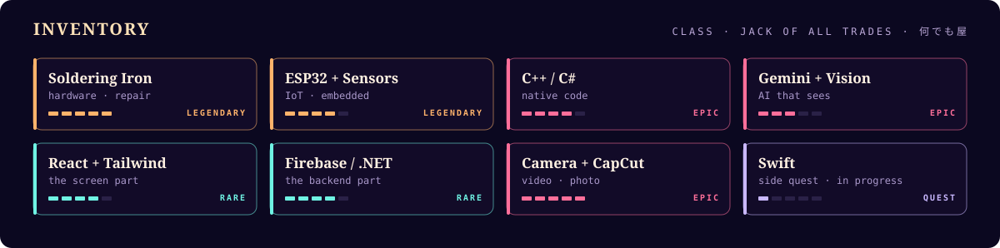

  

  <i>“A jack of all trades is a master of none, but oftentimes better than a master of one.”</i>

  
  

<!--TONIGHT:START-->

  📻 <b>ON THE DECK TONIGHT</b> 
  <a href="https://open.spotify.com/search/R%20U%20Mine%3F%20Arctic%20Monkeys"><b>R U Mine?</b> — Arctic Monkeys</a> 
  <i>“It's dangerous to go alone! Take this.” — The Legend of Zelda</i>

<!--TONIGHT:END-->

 

 

<table align="center"><tr><td>

**⟡ currently in the workshop**
&nbsp;[`steam-ipad`](https://github.com/Aiman2404/steam-ipad) — a Steam Deck-style music deck for iPad: Spotify control, synced lyrics, one-click laptop link.

**⟡ side quests**
&nbsp;night drives · football · way too many games · mythology rabbit holes · anime (yes, the long ones)

</td></tr></table>

 

<h3 align="center">🍾 message in a bottle</h3>

  Throw a short message into the sea — it washes up right here, on this page. 
  <a href="https://github.com/Aiman2404/Aiman2404/issues/new?title=bottle%3A%20&body=Write%20your%20message%20in%20the%20title%20after%20%22bottle%3A%22%20%E2%80%94%20max%2090%20characters.%20Hit%20Submit%20and%20it%20lands%20on%20the%20profile%20in%20a%20few%20seconds."><b>→ throw a bottle</b></a>

<!--BOTTLES:START-->

<i>the shore is quiet… be the first.</i>

<!--BOTTLES:END-->

the sky redraws itself every night from my commits · the track and the quote change daily

